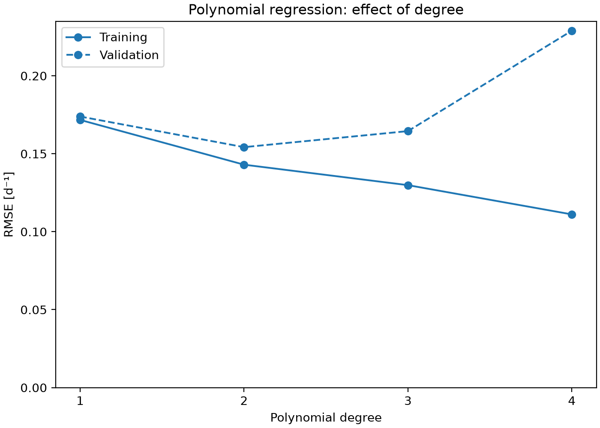
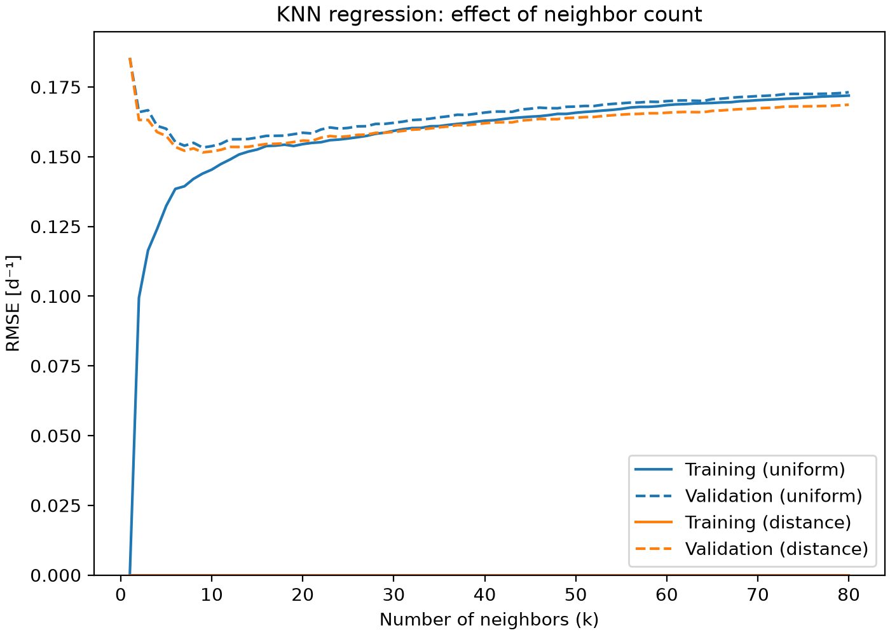
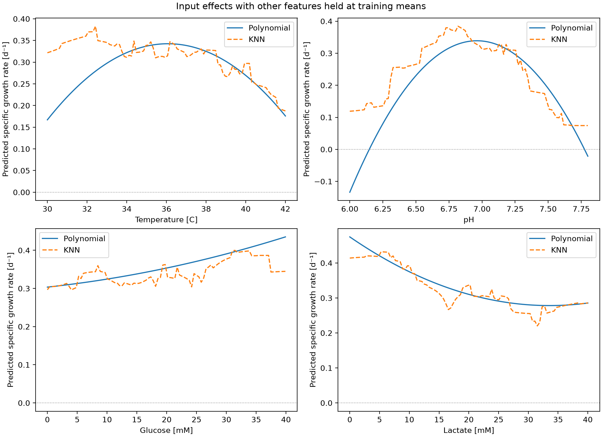

# Cell Growth Rate Prediction

This project predicts the specific growth rate of a cell culture from its temperature, pH, glucose concentration, and lactate concentration. It loads a simulated cell culture dataset, tunes polynomial and k-nearest neighbors regression models with grid search cross-validation, evaluates the selected model on held-out samples, and exports comparison tables and figures. The model helps explore which culture conditions favour or limit growth, a quantity that cannot be controlled directly.

## Highlights

- Built reproducible scikit-learn pipelines for growth rate regression
- Tuned polynomial and k-nearest neighbors models with grid search cross-validation
- Diagnosed underfitting and overfitting using validation curves
- Evaluated the selected model on held-out test data
- Visualized one-factor input effects and exported analysis tables

## Environment

- Python 3.14.7
- matplotlib 3.11.0
- numpy 2.5.2
- pandas 3.0.5
- scikit-learn 1.9.0

## Code Design

Running `main.py` executes the workflow below from top to bottom. Settings such as the split ratio, random seed, and hyperparameter grids are defined in `src/constants.py`, and the reusable steps live in `src/functions.py`, so `main.py` reads as a short outline of the analysis.

### Data loading and inspection

The program reads the CSV file using a path built relative to `main.py`, then prints a preview, the table dimensions, and the number of missing values in each column. This stage is necessary because every later step assumes complete data in the expected shape: here, 318 samples with four culture conditions and one growth rate each, and no missing values. Building the path relative to the script lets the project be moved to another computer without editing any file paths.

### Separating features and target, then splitting the data

The four culture conditions (temperature, pH, glucose, and lactate) become the feature matrix, and the specific growth rate becomes the target. The samples are then randomly split into 254 training samples and 64 test samples, using a fixed random seed so the split is reproducible. A model should be judged on data that was not used to develop it, so the split happens before any scaling or fitting, which prevents information from the test samples leaking into the model. From this point on, all tuning uses the training samples only, and the test samples are kept aside for the final evaluation.

### Building model pipelines

Each candidate model is a pipeline. The polynomial pipeline standardizes the inputs, expands them into polynomial terms without a separate bias column, and fits a linear regression. The k-nearest neighbors pipeline standardizes the inputs and then applies k-nearest neighbors regression. Standardization is needed because the inputs are on very different scales (temperature spans roughly 30 to 42, while pH spans 6 to 7.8). Placing all features on a similar scale keeps distance calculations fair in k-nearest neighbors and keeps polynomial weights comparable. Wrapping the steps in one pipeline ensures the scaler is fitted only on the samples a model is training on, including inside every cross-validation fold, which reduces the risk of mixing training and validation data.

### Tuning the polynomial model

Grid search cross-validation compares polynomial degrees 1 to 4 using four folds drawn from the training samples, scored by root mean square error (RMSE). It records both training and validation scores for each degree. The degree is a hyperparameter: it cannot be learned while the weights are fitted, so it has to be compared on data held out from each fold. Comparing training and validation error shows whether a degree underfits or overfits. This stage produces a ranked table of degrees, and the best pipeline is refitted on all training samples.

### Tuning the k-nearest neighbors model

The same procedure is applied to k-nearest neighbors regression, searching every neighbor count from 1 to 80 with both uniform and distance weighting. The number of neighbors and the weighting method are hyperparameters, so they are also chosen with validation folds. Using the same folds and the same RMSE scoring as the polynomial search makes the two model families directly comparable. This stage produces a second ranked table and a best-performing k-nearest neighbors model that serves as the main alternative to the polynomial.

### Final evaluation on held-out data

The selected degree-2 polynomial and the best k-nearest neighbors model are each scored once on the training samples and on the test samples. The program reports RMSE, the coefficient of determination (R²), and the number of negative test predictions. The test samples played no part in fitting or tuning, so they estimate how well each model generalizes to new data. Comparing training and test error also reveals overfitting. This stage supplies the final performance figures cited in the analysis, and the k-nearest neighbors model is included for comparison only.

### Exporting tables and figures

The program saves every candidate's cross-validation results as CSV tables, plots the validation curves for both model families, and creates a one-factor effect figure. In that figure, each input is varied across its observed range while the other three are held at their training-set means, and both models make predictions along the way. Error scores alone do not show how a model behaves, whereas these outputs reveal curve shapes, disagreements between models, and impossible negative predictions. The files are saved in the `tables/` and `figures/` folders and form the evidence for the analysis below.

## Analysis

### Model selection and justification

The selected model is a degree-2 polynomial regression: a standardization step, then polynomial expansion with `degree=2` and `include_bias=False`, then ordinary linear regression. It was chosen using cross-validation evidence from the training samples, for three reasons.

**Degree 2 balances underfitting and overfitting.** The polynomial degree controls model complexity, and the table below shows the bias-variance tradeoff directly.

| Degree | Training RMSE [d⁻¹] | Validation RMSE [d⁻¹] | Validation SD |
|---|---|---|---|
| 1 | 0.1717 | 0.1739 | 0.0080 |
| 2 | 0.1430 | 0.1542 | 0.0104 |
| 3 | 0.1299 | 0.1645 | 0.0180 |
| 4 | 0.1111 | 0.2289 | 0.0580 |

Degree 1 has high error on both training and validation folds, which indicates underfitting: a straight-line model cannot capture the curvature in the data. Degree 2 lowers both errors and has the lowest validation RMSE. Degrees 3 and 4 keep reducing training error but increase validation error, and the fold-to-fold spread grows sharply at degree 4. This widening gap is the signature of overfitting. Because the best degree sits inside the searched range of 1 to 4, the grid did not need to be widened.

**Accuracy is similar to the best alternative.** The best k-nearest neighbors model reaches a validation RMSE of 0.1515 d⁻¹, compared with 0.1542 d⁻¹ for the degree-2 polynomial. The difference of about 0.003 d⁻¹ is smaller than the fold-to-fold variation (standard deviations of roughly 0.010 to 0.011 d⁻¹). The two models therefore perform similarly on validation data. No formal statistical test was performed, so this should be read as similarity and not as a proven tie. When performance is similar, the simpler or more interpretable model is preferable.

**The polynomial is easier to interpret.** It is a parametric model with a fixed structure: 14 weights on standardized features plus an intercept, covering linear, squared, and interaction terms. Its prediction is an explicit equation that can be examined for curvature and interactions. The k-nearest neighbors model is non-parametric, so its behaviour can only be inspected indirectly, for example by plotting predictions as one input changes.

Interpretability supports this choice but does not establish that the fitted curves reflect true biology. The model describes patterns in the supplied data and nothing more.

### Comparison with k-nearest neighbors

The k-nearest neighbors search covered 1 to 80 neighbors with uniform and distance weighting.

With one neighbor, validation RMSE is 0.1854 d⁻¹ while training RMSE is zero, so the model overfits by memorizing each sample. Validation error falls to its minimum of 0.1515 d⁻¹ at nine neighbors with distance weighting. Beyond that it rises slowly, reaching about 0.169 to 0.173 d⁻¹ at 80 neighbors, as predictions average over too many dissimilar samples and the model begins to underfit.

Distance weighting gives a training RMSE of exactly zero at every neighbor count, because each training sample is its own nearest neighbor at zero distance. This perfect training fit is not evidence of quality. With nine neighbors, uniform weighting has a training RMSE of 0.1439 d⁻¹ and a validation RMSE of 0.1533 d⁻¹, a much smaller train-validation gap than distance weighting. Its validation error is only slightly higher, so it is a more balanced k-nearest neighbors alternative.

After model selection, both fixed candidates were scored on the 64 test samples:

| Model | Training RMSE [d⁻¹] | Test RMSE [d⁻¹] | Training R² | Test R² | Negative test predictions |
|---|---|---|---|---|---|
| Polynomial, degree 2 (selected) | 0.1444 | 0.1570 | 0.381 | 0.384 | 0 |
| k-nearest neighbors, 9 neighbors, distance weights (comparison only) | 0.0000 | 0.1587 | 1.000 | 0.371 | 0 |

The polynomial's training and test errors are close, which gives no sign of overfitting. The k-nearest neighbors model fits its training samples perfectly but performs no better on the test samples. The test results were reported after the choice was made and were not used to tune or change it. Because the test set contains only 64 samples, the 0.0017 d⁻¹ difference between the models is small and should not be over-interpreted. A test R² of 0.384 means the polynomial predicts better than simply using the mean growth rate, but about 60% of the variance in growth rate remains unexplained.

### Effect of each culture condition

The figure below varies one input at a time across its observed range, holding the other three at their training-set means (37.0 °C, pH 7.0, 15.1 mM glucose, and 15.0 mM lactate).

**pH** has the strongest effect. The polynomial peaks near pH 6.96 and the k-nearest neighbors model near pH 6.8, and both decline toward the high-pH end. On the low-pH side, the polynomial falls steeply, to −0.134 d⁻¹ at pH 6.0, while k-nearest neighbors stays at 0.119 d⁻¹.

**Lactate** reduces growth. The polynomial predicts 0.475 d⁻¹ with no lactate, falling to a minimum of 0.278 d⁻¹ near 33.5 mM. The k-nearest neighbors prediction falls from about 0.43 d⁻¹ near 5 mM to about 0.22 d⁻¹ near 31.5 mM. Both models level off or recover slightly above about 30 mM, where fewer samples constrain them.

**Temperature** has a moderate effect. The polynomial peaks near 36 °C at 0.343 d⁻¹ and falls toward both ends. The k-nearest neighbors model shows a broad plateau of roughly 0.31 to 0.38 d⁻¹ from 30 to 38 °C, then declines to 0.187 d⁻¹ at 42 °C. Both models agree that growth is lower at the hot end.

**Glucose** has the smallest effect. The polynomial rises steadily from 0.304 d⁻¹ at 0 mM to 0.435 d⁻¹ at 40 mM. The k-nearest neighbors prediction rises to about 0.40 d⁻¹ near 31 mM and then falls to 0.345 d⁻¹ at the upper limit.

Ranked by the change in predicted growth rate across each input's observed range, both models order the inputs the same way: pH, then lactate, then temperature, then glucose. These curves describe predicted changes at the reference conditions only. Because the polynomial contains interaction terms, the effect of one input can depend on the others, so the curves should not be read as universal effects, and they do not prove causation.

### Conditions for high and low growth

**High growth** is suggested by a pH near 6.8 to 7.0, a temperature between roughly 32 and 38 °C, low lactate (below about 10 mM), and moderate to high glucose. Along these one-factor curves, the highest predicted growth rates are about 0.34 to 0.48 d⁻¹. The dataset contains growth rates up to 0.75 d⁻¹, so the models predict values well below the highest observed ones, which reflects both averaging and the fact that each curve varies a single input. Whether combining all favourable settings produces still higher growth was not tested directly, and interaction terms mean the combined effect may not be additive.

**Low growth** is suggested by a pH far from the optimum, especially below about 6.3, lactate above about 30 mM, temperatures near 42 °C, and glucose near zero. Predicted growth rates at these extremes are roughly 0.18 to 0.30 d⁻¹ for lactate, temperature, and glucose, with the largest drop at low pH. The dataset also contains 24 samples with exactly zero growth. Neither model reproduces exact zeros.

### Where predictions may not be reliable

- **Extreme pH.** The polynomial predicts impossible negative growth rates at both ends of the pH range: 11 of the 100 pH values examined, concentrated near pH 6.0 to 6.15 and at 7.8. The k-nearest neighbors model predicts positive values there (0.119 d⁻¹ at pH 6.0), so the two models disagree.
- **Cold temperatures.** At 30 °C the polynomial predicts 0.167 d⁻¹ and the k-nearest neighbors model predicts 0.322 d⁻¹, which shows the data do not pin down growth at low temperature.
- **Sparsely sampled regions.** Of the 318 samples, only 21 lie outside 32 to 40 °C, 17 outside pH 6.3 to 7.6, 21 above 30 mM lactate, and 32 below 3 mM glucose. Predictions in these regions rely on few samples.
- **Outside the observed ranges.** The data cover 30 to 42 °C, pH 6.0 to 7.8, and 0 to 40 mM for both glucose and lactate. A polynomial can extrapolate without bound beyond these ranges, and k-nearest neighbors can never predict outside the range of growth rates it has seen, so neither should be trusted there.
- **Zero-growth samples.** The 24 zero-growth samples cannot be reproduced, so conditions that stop growth completely are poorly represented.
- **General noise.** With a test R² of 0.384, individual predictions carry considerable uncertainty even inside the well-sampled region.

### Advantages and limitations

The degree-2 polynomial is fast to train, has a fixed number of parameters, and produces an explicit equation that includes curvature and interactions. Its training and test errors are close, and the pipeline standardizes inputs using training data only, which keeps evaluation honest. A single validation procedure was used for every candidate, which makes the comparisons fair and reproducible.

Its limitations are equally important. It explains only part of the variation in growth rate. It cannot enforce a minimum of zero, as the negative predictions show. A single quadratic shape cannot capture sharp transitions, such as a sudden collapse in growth at stressful conditions. The evaluation relies on one random split with a small test set of 64 samples, so the reported errors carry uncertainty. The data are simulated and include only four inputs, and no regularized or more flexible models were explored. The k-nearest neighbors alternative has its own weaknesses: it cannot extrapolate, produces a jagged response, and fits training data perfectly with distance weights.

### Potential applications

The model could help screen candidate temperature and pH set points before running experiments, narrowing the region worth testing. It could support monitoring of glucose and lactate, since rising lactate predicts slower growth. It could also serve as a baseline for comparison with more advanced models, or as a simple decision-support tool inside a process simulation.

In practice, the pipeline should be used as a whole so the same standardization is applied to new data, conditions should stay inside the ranges listed above, and any negative prediction should be treated as zero growth. Before the model informs real decisions, it should be validated against measured data from actual cultures, preferably with more samples and additional inputs.
